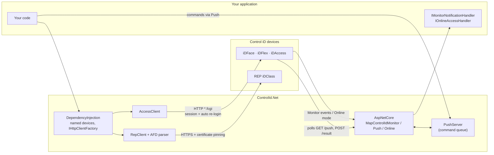

# ControlId.Net

[](https://github.com/DaviLuisSantos/ControlId.Net/actions/workflows/ci.yml)
[](https://www.nuget.org/packages/ControlId.Net)
[](https://www.nuget.org/packages/ControlId.Net.DependencyInjection)
[](https://www.nuget.org/packages/ControlId.Net.AspNetCore)
[](LICENSE)

**English** · [Português](README.pt-BR.md)

An unofficial, fully typed .NET SDK for [Control iD](https://www.controlid.com.br) hardware: the access control line
(iDAccess, iDFlex, iDFace, iDBox, iDUHF) and the iDClass time clocks (REP) used for legal timekeeping in Brazil.

Control iD devices are everywhere in Brazilian offices, condos and factories, but their HTTP API is undocumented in places,
inconsistent across firmware versions, and has no official .NET client. ControlId.Net turns it into a typed, async,
dependency-injection-friendly library, verified against real devices.

> Independent project, not affiliated with Control iD. "Control iD", "iDAccess", "iDFlex", "iDFace" and "iDClass" are
> trademarks of Control iD.

## Highlights

- **Complete API coverage, enforced by tests.** All 85 endpoints, 37 objects and 34 configuration sections of the access
  API, plus all 47 commands of the iDClass API. A test fails if any documented endpoint lacks a typed method
  ([coverage matrix](docs/COBERTURA.md)).
- **Verified on real hardware.** Discrepancies between the docs and the firmware (wrong endpoint names, typos in JSON
  fields, events that never fire) were found on real iDFace devices and handled in code, each one recorded.
- **Real-time integrations.** Monitor (webhooks), Push (command queue for devices behind NAT) and Online mode (your server
  authorizes each access) as ASP.NET Core endpoints in one line.
- **Brazilian labor law compliance.** A streaming parser for the AFD file of Portaria 671/2021 and 1510/2009, with
  CRC-16/KERMIT validation, that survives corrupt lines.
- **Safe by default.** Destructive operations require an explicit `DataLossConfirmation.Confirmed`; optional SHA-256
  certificate pinning for self-signed device certificates; per-device concurrency limits sized from measurements on real
  devices.
- **Observable.** OpenTelemetry traces and metrics per command: latency, re-logins and requests queued per device,
  without forcing an OpenTelemetry dependency on you.
- **Runs anywhere .NET runs.** `net8.0` and `netstandard2.0` targets, tested on .NET 8, .NET 10 and .NET Framework 4.8.

## Architecture



The device calls your server in three of the four integration modes. The SDK never opens a port by itself: it parses
what the device sends and plugs into the routing of the framework you already use.

## Quick start

```bash
dotnet add package ControlId.Net --prerelease
```

```csharp
using ControlId.Access;

using var device = new AccessClient("http://192.168.0.129", "admin", "admin");

// Login happens on the first call and is redone when the session expires.
var id = await device.CreateUserAsync(new AccessUser { Name = "Maria", Registration = "1020" });
await device.SetUserImageAsync(id, File.ReadAllBytes("maria.jpg"));   // photo; the face template on iDFace
await device.OpenDoorAsync(door: 1);

// Large databases are read page by page, on demand.
long lastId = 0;
await foreach (var log in device.EnumerateAccessLogsAsync(afterId: lastId))
{
    lastId = log.Id;
}
```

Receive events in real time with ASP.NET Core:

```csharp
builder.Services.AddControlIdMonitor<AccessLogHandler>();
app.MapControlIdMonitor();   // POST /api/notifications/{endpoint}
```

Read punches from a time clock:

```csharp
using ControlId.Rep;
using ControlId.Rep.Afd;

using var rep = new RepClient("https://192.168.0.130", mode: RepMode.Portaria671);

AfdFile afd = await rep.GetAfdFileFromNsrAsync(lastNsr + 1);
foreach (var punch in afd.Punches)
{
    Console.WriteLine($"{punch.Nsr} {punch.Time:yyyy-MM-dd HH:mm} {punch.EmployeeId}");
}
```

The full guide (in Portuguese) covers every area of the API: users, cards, biometrics, access rules, device commands,
configuration, Push, Monitor, Online mode, REP, AFD, dependency injection and multi-device operations:
**[docs/guia.md](docs/guia.md)**.

## Try it without hardware

```bash
docker run --rm -p 8080:8080 ghcr.io/daviluissantos/controlid-simulator
```

The [device simulator](tools/ControlId.Net.Simulator/README.md) speaks the access API with in-memory state and sends
Monitor notifications, reproducing the firmware quirks the SDK handles. Point `AccessClient` at `http://localhost:8080`
and trigger a person at the device with `POST /simulator/identify`.

## Packages

| Package | Purpose |
| --- | --- |
| `ControlId.Net` | `AccessClient`, `RepClient`, AFD parser, Push and Monitor models |
| `ControlId.Net.DependencyInjection` | `AddControlIdAccess` / `AddControlIdRep`, many devices from `appsettings.json` |
| `ControlId.Net.AspNetCore` | Push, Monitor and Online mode endpoints for ASP.NET Core (net8.0+) |

## Engineering

| Practice | How |
| --- | --- |
| Tests | 427 unit tests on .NET 8 and .NET 10, 414 on .NET Framework 4.8; end-to-end tests over real HTTP against the [device simulator](tools/ControlId.Net.Simulator/README.md) |
| CI | Every push and pull request: warning-free build, three target frameworks on Linux and Windows, coverage summary |
| API governance | Public API tracked in `PublicAPI.*.txt`; `dotnet pack` fails on undeclared breaking changes against the last release |
| Supply chain | NuGet Trusted Publishing (OIDC, no stored keys), CycloneDX SBOM, build provenance attestation, deterministic builds, SourceLink |
| Static analysis | .NET `latest-recommended` rule set with zero warnings, nullable reference types everywhere |
| Decisions | [Architecture Decision Records](docs/adr/README.md) for the key design choices |
| Security | [Private vulnerability reporting](SECURITY.md) and safe-usage notes |

## Roadmap

- [x] Full coverage of the public access API and of the iDClass API
- [x] Push, Monitor and Online mode on ASP.NET Core
- [x] AFD parser (Portaria 671 and 1510)
- [x] Device simulator in a Docker image, with integration tests that run in CI
- [x] OpenTelemetry traces and metrics, with an Aspire dashboard demo
- [ ] Structured logs (`ILogger` with source-generated `LoggerMessage`)
- [x] Health checks for every registered device
- [ ] Retries for read-only commands and a circuit breaker per device
- [ ] Native AOT and trimming support
- [ ] Real-time dashboard sample (Blazor + SignalR)

## Contributing

See [CONTRIBUTING.md](CONTRIBUTING.md). Bug reports from real devices are especially welcome: please include the model
and firmware version.

## License

[MIT](LICENSE)
