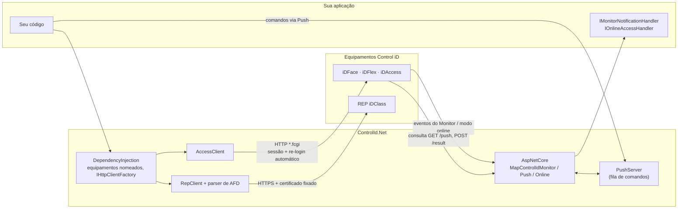
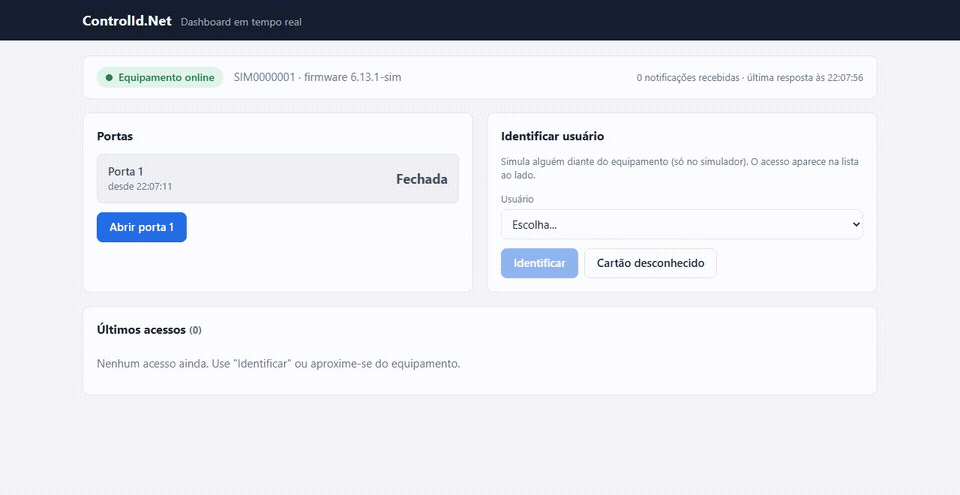

# ControlId.Net

[](https://github.com/DaviLuisSantos/ControlId.Net/actions/workflows/ci.yml)
[](https://www.nuget.org/packages/ControlId.Net)
[](https://www.nuget.org/packages/ControlId.Net.DependencyInjection)
[](https://www.nuget.org/packages/ControlId.Net.AspNetCore)
[](LICENSE)

[English](README.md) · **Português**

SDK .NET **não oficial** e totalmente tipado para equipamentos [Control iD](https://www.controlid.com.br): a linha de
acesso (iDAccess, iDFlex, iDFace, iDBox, iDUHF) e os relógios de ponto REP iDClass.

Os equipamentos Control iD estão em escritórios, condomínios e fábricas de todo o Brasil, mas a API HTTP deles tem
lacunas na documentação, muda entre versões de firmware e não tem cliente .NET oficial. O ControlId.Net transforma essa
API numa biblioteca tipada, assíncrona e pronta para injeção de dependência, conferida em equipamentos reais.

> Projeto independente, sem vínculo com a Control iD. "Control iD", "iDAccess", "iDFlex", "iDFace" e "iDClass" são marcas
> da Control iD.

## Destaques

- **Cobertura completa da API, garantida por testes.** Os 85 endpoints, 37 objetos e 34 seções de configuração da API de
  acesso, e os 47 comandos da API do iDClass. Um teste falha se algum endpoint documentado ficar sem método tipado
  ([matriz de cobertura](docs/COBERTURA.md)).
- **Conferido em equipamento real.** Divergências entre a documentação e o firmware (nomes de endpoint errados, erros de
  digitação em campos JSON, eventos que nunca chegam) foram encontradas em iDFaces reais e tratadas no código, cada uma
  registrada.
- **Integrações em tempo real.** Monitor (webhooks), Push (fila de comandos para equipamentos atrás de NAT) e modo online
  (o seu servidor autoriza cada acesso) como rotas do ASP.NET Core numa linha.
- **Conformidade com a legislação.** Parser em streaming do AFD da Portaria 671/2021 e da 1510/2009, com validação de
  CRC-16/KERMIT, que não para numa linha corrompida e lê 100 mil marcações em cerca de 20 ms
  ([benchmarks](benchmarks/README.md)).
- **Seguro por padrão.** Operações destrutivas exigem `DataLossConfirmation.Confirmed`; certificado fixado por SHA-256
  opcional para os certificados autoassinados dos equipamentos; limite de requisições simultâneas por equipamento,
  dimensionado com medições em equipamento real.
- **Observável.** Traces e métricas do OpenTelemetry por comando: latência, re-logins e requisições na fila por
  equipamento, sem impor uma dependência do OpenTelemetry.
- **Roda onde o .NET roda.** Alvos `net8.0` e `netstandard2.0`, testados no .NET 8, no .NET 10 e no .NET Framework 4.8.

## Arquitetura



Em três dos quatro modos de integração é o equipamento que chama o seu servidor. O SDK não abre porta nenhuma sozinho:
interpreta o que o equipamento envia e se liga nas rotas do framework que você já usa.

## Início rápido

```bash
dotnet add package ControlId.Net --prerelease
```

```csharp
using ControlId.Access;

using var device = new AccessClient("http://192.168.0.129", "admin", "admin");

// O login é feito na primeira chamada e refeito quando a sessão expira.
var id = await device.CreateUserAsync(new AccessUser { Name = "Maria", Registration = "1020" });
await device.SetUserImageAsync(id, File.ReadAllBytes("maria.jpg"));   // foto; no iDFace, o cadastro da face
await device.OpenDoorAsync(door: 1);

// Bases grandes são lidas em páginas, sob demanda.
long ultimoId = 0;
await foreach (var log in device.EnumerateAccessLogsAsync(afterId: ultimoId))
{
    ultimoId = log.Id;
}
```

Eventos em tempo real com ASP.NET Core:

```csharp
builder.Services.AddControlIdMonitor<LogDeAcessoHandler>();
app.MapControlIdMonitor();   // POST /api/notifications/{endpoint}
```

Marcações de um relógio de ponto:

```csharp
using ControlId.Rep;
using ControlId.Rep.Afd;

using var rep = new RepClient("https://192.168.0.130", mode: RepMode.Portaria671);

AfdFile afd = await rep.GetAfdFileFromNsrAsync(ultimoNsr + 1);
foreach (var marcacao in afd.Punches)
{
    Console.WriteLine($"{marcacao.Nsr} {marcacao.Time:dd/MM/yyyy HH:mm} {marcacao.EmployeeId}");
}
```

O guia completo cobre todas as áreas da API: usuários, cartões, biometria, regras de acesso, comandos do equipamento,
configurações, Push, Monitor, modo online, REP, AFD, injeção de dependência e operações em vários equipamentos:
**[docs/guia.md](docs/guia.md)**.

## Experimente sem equipamento

```bash
docker run --rm -p 8080:8080 ghcr.io/daviluissantos/controlid-simulator
```

O [simulador de equipamento](tools/ControlId.Net.Simulator/README.md) fala a API de acesso com estado em memória e envia
as notificações do Monitor, reproduzindo as divergências do firmware que o SDK trata. Aponte o `AccessClient` para
`http://localhost:8080` e simule uma pessoa no equipamento com `POST /simulator/identify`. Ele também simula o REP iDClass
(`--Simulator:Kind=Rep`, marcações com `POST /simulator/punch`), o Push e o modo online.

`docker compose -f samples/docker-compose.yml up --build` sobe também o
[dashboard em tempo real](samples/ControlId.Net.Dashboard) em `http://localhost:8081`, que configura o Monitor do
equipamento sozinho e atualiza ao vivo:



## Pacotes

| Pacote | Para quê |
| --- | --- |
| `ControlId.Net` | `AccessClient`, `RepClient`, parser de AFD, modelos de Push e Monitor |
| `ControlId.Net.DependencyInjection` | `AddControlIdAccess` / `AddControlIdRep`, vários equipamentos pelo `appsettings.json` |
| `ControlId.Net.AspNetCore` | Rotas de Push, Monitor e modo online no ASP.NET Core (net8.0+) |

## Engenharia

| Prática | Como |
| --- | --- |
| Testes | 494 testes unitários no .NET 8 e no .NET 10, 481 no .NET Framework 4.8 e 32 de integração; testes de ponta a ponta com HTTP de verdade contra o [simulador de equipamento](tools/ControlId.Net.Simulator/README.md) |
| Teste de mutação | Stryker.NET: nota de mutação de 68,08% em `src/ControlId.Net` (1.216 mortos, 23 timeout, 425 sobreviventes) |
| Site de documentação | [Referência da API e guia](https://daviluissantos.github.io/ControlId.Net/), publicado pelo workflow `docs.yml` (DocFX) |
| CI | A cada push e pull request: build sem avisos, três alvos no Linux e no Windows, resumo de cobertura |
| Governança da API | API pública registrada em `PublicAPI.*.txt`; o `dotnet pack` falha numa quebra não declarada em relação à última versão |
| Cadeia de suprimentos | Trusted Publishing no NuGet (OIDC, sem chave guardada), SBOM CycloneDX, atestação de proveniência, builds determinísticos, SourceLink |
| Desempenho | [BenchmarkDotNet](benchmarks/README.md): o parser de AFD ficou 6,5× mais rápido e aloca 59% menos, protegido por testes de borda e diferenciais |
| Análise estática | Regras `latest-recommended` do .NET sem nenhum aviso, nullable em todo o código |
| Native AOT | Avaliado, sem declarar compatibilidade: [ADR 0015](docs/adr/0015-native-aot.md) e a sonda em `tools/ControlId.Net.AotProbe` (3 IL2026, 3 IL3050, 1 IL2070) |
| Decisões | [Registros de decisão de arquitetura](docs/adr/README.md) para as escolhas de projeto importantes |
| Segurança | [Relato privado de vulnerabilidades](SECURITY.md) e orientações de uso seguro |

## Roadmap

- [x] Cobertura completa da API pública de acesso e da API do iDClass
- [x] Push, Monitor e modo online no ASP.NET Core
- [x] Parser de AFD (Portaria 671 e 1510)
- [x] Simulador de equipamento em imagem Docker, com testes de integração na CI
- [x] Traces e métricas com OpenTelemetry, com demonstração no dashboard do Aspire
- [x] Logs estruturados (`ILogger` com `LoggerMessage` gerado)
- [x] Health checks de todos os equipamentos registrados
- [x] Novas tentativas em comandos de leitura (nunca em comandos que alteram o equipamento)
- [ ] Circuit breaker por equipamento
- [x] Benchmarks do parser de AFD
- [x] Avaliação de Native AOT ([ADR 0015](docs/adr/0015-native-aot.md))
- [ ] Suporte a Native AOT e trimming (JSON com source generation, corpos tipados)
- [x] Sample de dashboard em tempo real (Blazor Server, [samples/ControlId.Net.Dashboard](samples/ControlId.Net.Dashboard), `http://localhost:8081` no compose)

## Contribuindo

Veja o [CONTRIBUTING.md](CONTRIBUTING.md). Relatos de equipamentos reais são especialmente bem-vindos: informe o modelo e
a versão do firmware.

## Licença

[MIT](LICENSE)
