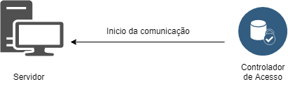

<!-- fonte: https://www.controlid.com.br/docs/access-api-pt/ -->

# Introdução

Esta documentação tem a finalidade de facilitar o processo de integração aos equipamentos da linha de controle de acesso da ControliD.

Aqui é descrito como realizar a comunicação através de sua API, como realizar operações desde o cadastro de usuários até identificação ou consulta a registros, além de estarem inclusos exemplos de requisições e respostas para cada operação apresentada.

Os dispositivos de acesso da Control iD oferecem uma interface de comunicação moderna por API (Application Programming Interface) baseada em TCP/IP (Ethernet) com uma arquitetura REST. Isso torna a integração simples e independente de sistema operacional ou linguagem de programação utilizados.

São oferecidos dois modos de funcionamento para a API: Autônomo (Standalone) e Online (Pro ou Enterprise), todos em API [REST](https://pt.wikipedia.org/wiki/REST).

## Exemplos de código e requisições

No repositório GitHub da Control iD estão disponíveis exemplos de código nas linguagens:

- C#
- Delphi
- Java
- NodeJS
- Python

**Exemplos de código:**
<https://github.com/controlid/integracao/tree/master/Controle%20de%20Acesso>

A maior parte dos exemplos dessa documentação foram escritos em **JavaScript**, utilizando a biblioteca **jQuery**. Para testá-los, acesse o endereço IP do equipamento em um navegador web e use as ferramentas do desenvolvedor (developer tools) deste para realizar requisições.

Todos os exemplos fornecidos podem ser verificados copiando seus códigos e colando no console das ferramentas de desenvolvimento. Além disso, muitos exemplos de requisições estão disponíveis em nossa coleção compartilhada através do *Postman*:

**Exemplos de requisições HTTP:**
<https://documenter.getpostman.com/view/10800185/SztHW4xo>

## Modos de operação

As interações possíveis entre servidor e terminal de controle de acesso dependem do modo de operação em que este deverá funcionar. Os três modos de operação descritos em [Introdução aos Modos de Operação](modos-de-operacao/introducao-aos-modos-de-operacao.md) podem ser divididos em duas categorias: autônomo (standalone) ou online.

Equipamento autônomo:

> - [Modo Standalone](modos-de-operacao/introducao-aos-modos-de-operacao.md#modo-standalone): identificação e autorização no terminal **(recomendado)**

Equipamento online:

> - [Modo Pro](modos-de-operacao/introducao-aos-modos-de-operacao.md#modo-pro): identificação no terminal e autorização no servidor
> - [Modo Enterprise](modos-de-operacao/introducao-aos-modos-de-operacao.md#modo-enterprise): identificação e autorização no servidor

Em uma solução desenvolvida para terminais em **modo de operação autônomo** a comunicação se dará unilateralmente do servidor para cada terminal e deve se preocupar em manter os dados de usuários e regras de acesso atualizados.

Já quando a solução é desenvolvida utilizando terminais em algum dos **modos de operação online**, a comunicação ocorre em ambos os sentidos, pois a lógica dos processos de autorização e identificação estará no servidor ou parcialmente no servidor.

As **requisições enviadas pelo equipamento** quando está em algum modo online são descritas em [Eventos de Identificação Online](modos-de-operacao/eventos-de-identificacao-online.md)

## Monitor

Em todos os modos de operação descritos acima, para se monitorar eventos assíncronos emitidos pelo equipamento, será necessário utilizar os serviços disponibilizados pelo Monitor.

Os eventos assíncronos monitoráveis incluem: alteração nos logs de acesso e logs de alarme, cadastro remoto de credenciais de acesso, giros de catraca, abertura de portas e mudanças no modo de operação (ex. entrar e sair em operação padrão ou contingência).

As **requisições enviadas pelo equipamento** a partir do Monitor são descritas em [Introdução ao Monitor](monitor/introducao-ao-monitor.md).

## Push

Nesse mecanismo proativo de comunicação, o equipamento envia periodicamente requisições HTTP ao servidor em busca de comandos a serem executados.

Quando não há nada a ser feito pelo equipamento, o servidor deve enviar uma resposta vazia. Caso contrário, o servidor deve responder o comando a ser realizado e os parâmetros correspondentes.

Após o equipamento executar o comando lido do servidor, ele envia nova requisição contendo o resultado da operação. A esta requisição é esperada uma resposta vazia, que encerra a atividade até a próxima busca.

> > > > 

As **requisições enviadas pelo equipamento** bem como as respostas para comandos Push são descritas em [Introdução ao Push](modo-push/introducao-ao-push.md).
