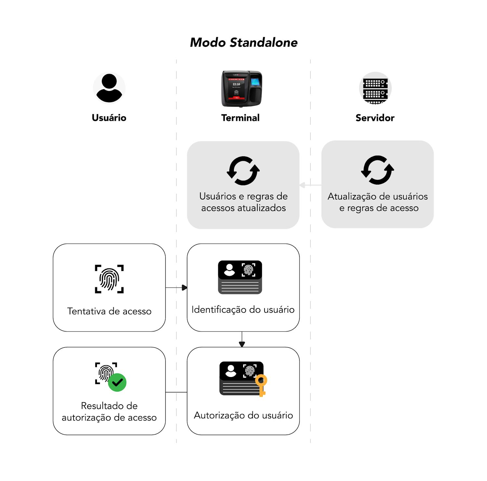
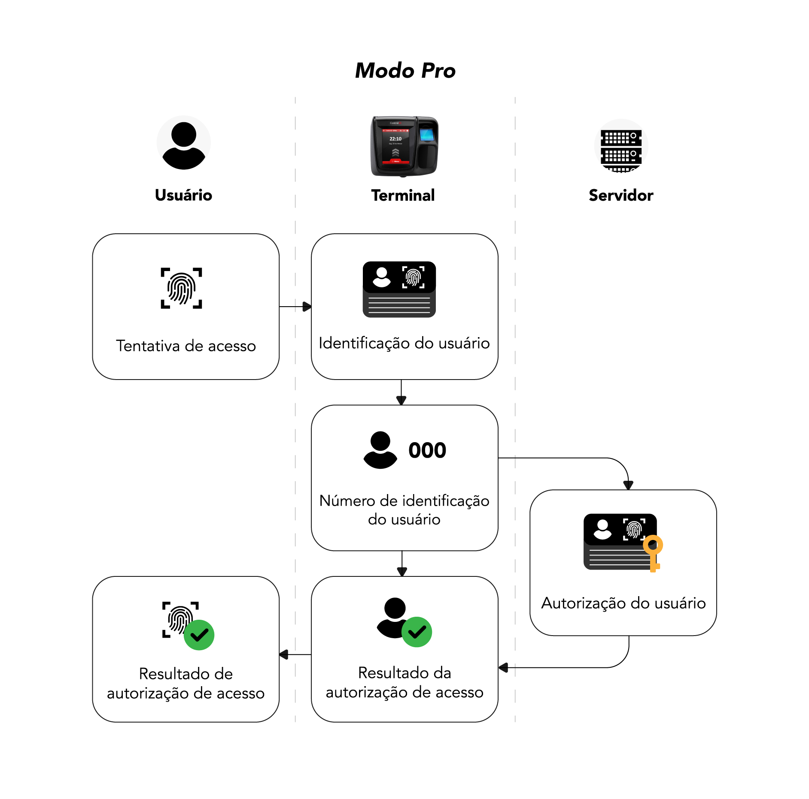
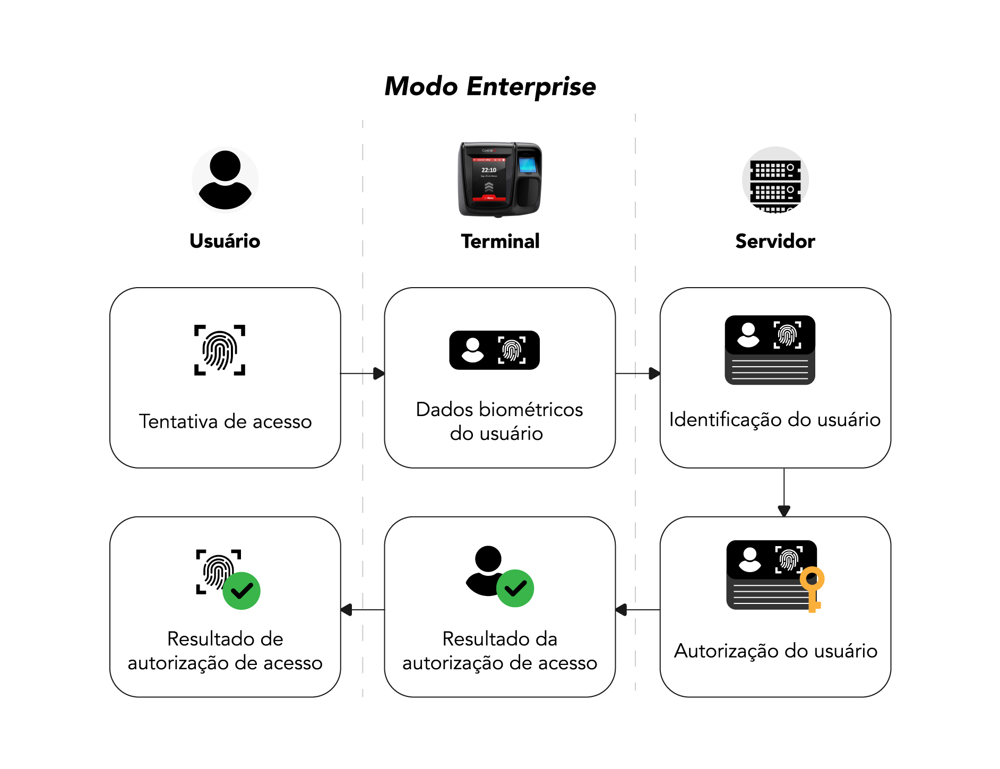

<!-- fonte: https://www.controlid.com.br/docs/access-api-pt/modos-de-operacao/introducao-aos-modos-de-operacao/ -->

# Introdução aos modos de operação

Os controladores de acesso da ControliD são programados para funcionarem em diferentes modos de operação que se adequam a diferentes cenários de implantação de seus clientes.

As interações possíveis entre servidor e terminal de controle de acesso dependem do modo de operação em que este deverá funcionar. Os modos de operação descritos a seguir podem ser divididos em duas categorias: autônomo ou online.

Em uma solução desenvolvida para terminais em um **modo de operação autônomo (standalone)**, a comunicação se dará unilateralmente do servidor para cada terminal e deve se preocupar em manter os dados de usuários e regras de acesso atualizados.

Já quando a solução é desenvolvida utilizando terminais em algum dos **modos de operação online**, a comunicação ocorre em ambos os sentidos, pois a lógica dos processos de autorização e identificação estará no servidor ou parcialmente no servidor.

Existem dois modos de operação online: o **Modo Enterprise** e o **Modo Pro**. Sua diferença fundamental está em quais tratamentos de acesso são delegados ao servidor externo e, portanto, em qual tipo de informação ele deve receber.

| Modo de Operação | Identificação | Autorização | Informação enviada na tentativa de acesso |
| --- | --- | --- | --- |
| Standalone | No terminal | No terminal | - |
| Pro | No terminal | No servidor | Número identificador do usuário |
| Enterprise | No servidor | No servidor | Dados biométricos do usuário |
| Contingência | No terminal | No terminal | - |

## Modo Standalone

***Identificação e autorização no terminal***

**Este é o modo de operação recomendado pela Control iD.**

Um equipamento está no Modo Standalone quando a configuração [*online*](../configuracoes/parametros-configuracao.md#general) estiver **desativada**.

Neste modo, o equipamento precisa ter seu banco de dados preenchido com todas as informações de que necessita para identificar e autorizar um acesso, isto é, cadastro de usuários, biometrias/cartões, departamentos, horários e regras de acesso.

Para fazer isso remotamente, basta enviar requisições diretamente para a API do equipamento.

> 

Desta forma, **os tratamentos de identificação e de autorização se dão totalmente no terminal**.

No modo Standalone, a informação é sempre enviada em um único sentido: do servidor para o equipamento.

## Modo Pro

***Identificação no terminal e autorização no servidor***

Um equipamento está no Modo Pro quando a configuração [*online*](../configuracoes/parametros-configuracao.md#general) estiver **ativada** e a configuração [*local_identification*](../configuracoes/parametros-configuracao.md#general) estiver **ativada**.

Neste modo, quando o usuário inicia uma identificação biométrica no equipamento, este analisa os dados captados através do seu próprio algoritmo biométrico e identifica o usuário correspondente em seu banco de dados local.

Apenas o ID do usuário identificado é enviado ao servidor para que este processe as regras de acesso e determine se deve ou não conceder a autorização.

> 

Desta forma, **o tratamento de identificação se dá totalmente no terminal** enquanto **o tratamento de autorização se dá totalmente no servidor**.

Repare que, por este método, o servidor precisa sempre manter atualizados os usuários e seus dados biométricos no equipamento, estando sujeito à limitação de registros existente nele. Esta limitação é descrita no tópico [Limitação do número de templates](../particularidade-dos-produtos/particulariade-terminais-control-id.md#limitacao-do-numero-de-templates).

## Modo Enterprise

***Identificação e autorização no servidor***

Um equipamento está no Modo Enterprise quando a configuração [*online*](../configuracoes/parametros-configuracao.md#general) estiver **ativada** e a configuração [*local_identification*](../configuracoes/parametros-configuracao.md#general) estiver **desativada**, para a IHM a configuração [*ihm_enterprise_mode*](../configuracoes/parametros-configuracao.md#general) também deve ser **ativada**.

Neste modo, quando o usuário inicia uma identificação biométrica no equipamento, este envia apenas uma imagem da biometria ao servidor. Cabe ao servidor fazer uso de algum algoritmo biométrico para processar a autorização do usuário.

> 

Desta forma, **os tratamentos de identificação e de autorização se dão totalmente no servidor**.

## Modo de contingência

***Identificação e autorização no terminal***

Se um equipamento operando em um dos modos online não conseguir se comunicar com o servidor por três tentativas seguidas, ele entrará em **modo de contingência**. Este é um modo de exceção e não pode ser usado como padrão nos equipamentos. O número de tentativas de comunicação com o servidor é um parâmetro configurável.

Neste modo, todas as identificações passam a ser feitas utilizando unicamente os registros locais do equipamento, que, para tanto, devem estar atualizados. O funcionamento é equivalente ao do Modo Standalone.

Enquanto estiver em contingência, a cada minuto, o equipamento enviará uma nova requisição [POST/device_is_alive](../modos-de-operacao/eventos-de-identificacao-online.md#verifica-disponibilidade-do-servidor) ao servidor. Assim que obtiver uma resposta (HTTP status code OK), ele voltará a seu modo de operação original.

Desta forma, **os tratamentos de identificação e de autorização se dão totalmente no terminal**.
