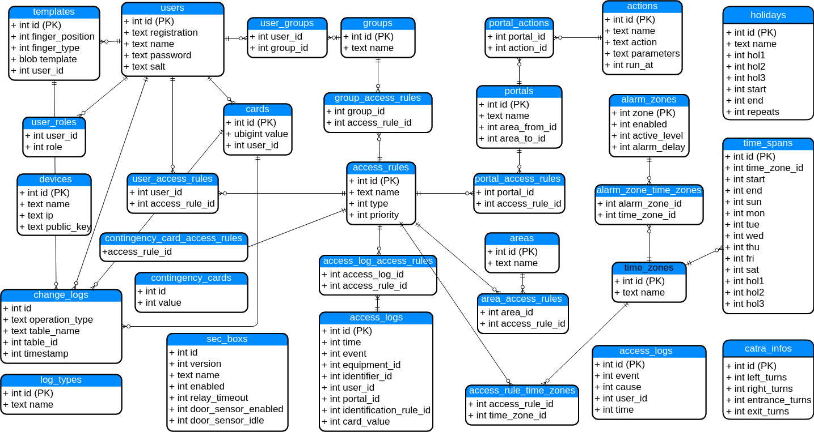

<!-- fonte: https://www.controlid.com.br/docs/access-api-pt/objetos/introducao-a-objetos/ -->

#### Introdução a Objetos

Os objetos mencionados nesta documentação representam as estruturas de dados interna do dispositivo, onde com o uso desta API registros podem ser criados, modificados e apagados.

A imagem abaixo descreve o relacionamento entre os objetos (tabelas) contidos no tópico [Lista de Objetos](../objetos/lista-de-objetos.md):

