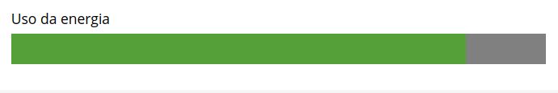

<!-- fonte: https://www.controlid.com.br/docs/access-api-pt/particularidade-dos-produtos/energia-idfacemax/ -->

# Energia iDFace Max

O iDFace Max possui um recurso gerenciamento de energia, no qual é possível configurar o uso energético de determinados periféricos para diferentes usos do equipamento.

Essa funcionalidade pode ser encontrada em :

- GUI: MENU -> Config. Gerais -> Config. Gerais -> Sistema -> Configurações de Energia
- Web: Configurações -> Configurações de energia

### Modos

#### Padrão (Fonte ou POE)

Uso padrão do equipamento em modo POE ou com a fonte fornecida ao equipamento

| Periférico | Valor |
| --- | --- |
| **Brilho do Display** | *6/10* |
| **Volume do alto falante** | *6/10* |
| **Intensidade do LED infravermelho** | *10/10* |
| **Intensidade do LED branco** | *10/10* |

#### Fonte externa 2A

Uso do equipamento com uma fonte externa 2A

| Periférico | Valor |
| --- | --- |
| **Brilho do Display** | *6/10* |
| **Volume do alto falante** | *10/10* |
| **Intensidade do LED infravermelho** | *10/10* |
| **Intensidade do LED branco** | *10/10* |

#### POE + Fechadura

Uso do equipamento alimentado pelo POE e acionando uma fechadura

| Periférico | Valor |
| --- | --- |
| **Brilho do Display** | *4/10* |
| **Volume do alto falante** | *6/10* |
| **Intensidade do LED infravermelho** | *10/10* |
| **Intensidade do LED branco** | *10/10* |

#### Personalizar

Ajuste fino do uso de energia do equipamento com diferentes periféricos

| Periférico | Valor |
| --- | --- |
| **Brilho do Display** | *3-10/10* |
| **Volume do alto falante** | *5-10/10* |
| **Intensidade do LED infravermelho** | *5-10/10* |
| **Intensidade do LED branco** | *5-10/10* |

### Periféricos

Contribuição estimada de cada periférico no consumo final:

| Periférico | Consumo |
| --- | --- |
| **Brilho do display** | *22%* |
| **Volume do alto falante** | *23%* |
| **Intensidade do LED infravermelho** | *8%* |
| **Intensidade do LED branco** | *4%* |
| **Restante do equipamento** (não ajustável) | *43%* |

### Uso

A representação visual abaixo indica a distribuição estimada do consumo:

- A barra verde indica o quanto o equipamento consome da fonte de energia.
- A barra cinza indica o quanto de energia restante da fonte está disponível para a fechadura
