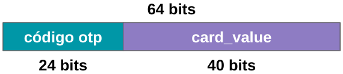

<!-- fonte: https://www.controlid.com.br/docs/access-api-pt/particularidade-dos-produtos/qr-code/ -->

# QR Code

É possível realizar identificações utilizando QR Codes cadastrados previamente nos equipamentos de controle de acesso da Control iD. Os [QR Codes são armazenados como objetos](../objetos/lista-de-objetos.md) e devem ser criados e modificados seguindo as mesmas premissas dos demais objetos via API.

A identificação dos QR Codes pode ser realizada através dos leitores de QR Code fornecidos pela Control iD, podendo-se optar entre o modelo USB e o modelo Wiegand. Além disso, para o dispositivo facial iDFace, a identificação pode ser realizada através das câmeras do próprio equipamento, porém, caso opte-se por utilizar leitores externos, esses também serão suportados pelo dispositivo.

### Modo de operação

O reconhecimento de QR Codes pode ser utilizado de três modos.

**Modo Somente Numérico (Padrão)**, na qual o conteúdo do QR Code deve ser numérico de 64 *bits* e, além disso, o QR Code será gravado como um objeto do tipo [***cards***](../objetos/lista-de-objetos.md#cards).

**Modo Numérico Hexadecimal** na qual o conteúdo do QR Code deve ser numérico Hexadecimal de 64 *bits* e seu valor será interpretado pelo dispositivo como numérico decimal. Além disso, o QR Code será gravado como um objeto do tipo [***cards***](../objetos/lista-de-objetos.md#cards).

No **Modo Alfanumérico** são aceitos caracteres alfanuméricos na representação do QR Code e o objeto utilizado para armazenamento será do tipo [***qrcodes***](../objetos/lista-de-objetos.md#qrcodes). Esse modo somente é suportado por equipamentos da Linha de Acesso V5 (dispositivos com serial de 13 dígitos) que estejam utilizando leitor de QR Code USB, ou pelo controlador de acesso iDFace, utilizando as câmeras do aparelho. O iDFace também é compatível com leitor de QR Code USB. Leitores de QR Code Wiegand **não são suportados** neste modo.

Para realizar a alteração do modo de operação, primeiro deve-se modificar o módulo conforme o equipamento utilizado. Os equipamentos da Linha de Acesso V5 utilizam o módulo `barras`, enquanto que para o controlador de acesso iDFace (Linha de Acesso V6) faz uso do módulo `face_id`. Após essa configuração é preciso alterar o valor do parâmetro `qrcode_legacy_mode_enabled`, sendo que caso o mesmo esteja com valor **"0"**, o **Modo Alfanumérico** será habilitado, caso seu valor seja **"1"**, o **Modo Somente Numérico** será habilitado e, caso seu valor seja **"2"**, o **Modo Numérico Hexadecimal** será utilizado.

#### Exemplo de requisição pelo controlador de acesso iDFace (Linha de Acesso V6)

Realiza a alteração do modo de operação do QR Code:

```
$.ajax({
    url: "/set_configuration.fcgi?session=" + session,
    type: 'POST',
    contentType: 'application/json',
    data: JSON.stringify({
        "face_id": {
            "qrcode_legacy_mode_enabled": "0"
        }
    })
});
```

#### Exemplo de requisição por equipamentos da Linha de Acesso V5

Realiza a alteração do modo de operação do QR Code:

```
$.ajax({
    url: "/set_configuration.fcgi?session=" + session,
    type: 'POST',
    contentType: 'application/json',
    data: JSON.stringify({
        "barras": {
            "qrcode_legacy_mode_enabled": "0"
        }
    })
});
```

### QR Code dinâmico

Os equipamentos de controle de acesso também podem trabalhar com o conceito de QR Code dinâmico, através da lógica de **TOTP** ou *timed one-time password*.

#### TOTP

O conceito de TOTP representa a geração de códigos de acesso válidos para um único uso e que se renovam a intervalos regulares.

Ele é uma extensão da ideia de **OTP**, *one-time password*, que é uma senha de uso único. Para TOTP, a validade de um código OTP fica restrita a uma janela de tempo determinada.

Códigos de acesso OTP válidos para TOTP são gerados por dois componentes: uma **chave de acesso** associada ao usuário ou a uma credencial de acesso e a **janela de tempo** em que o código é gerado.

Para aplicá-lo corretamente, é recomendado que o sistema integrador utilize uma biblioteca que implementa o TOTP conforme a [***RFC6238***](https://datatracker.ietf.org/doc/html/rfc6238) desenvolvida em sua linguagem de preferência.

#### Configurações de TOTP no equipamento

Para fazer uso de QR Codes dinâmicos, é necessário configurar os parâmetros de TOTP no equipamento:

- **totp_enabled**: habilita a lógica TOTP para validação de códigos temporários. Os valores são 0 (desabilitado) ou 1 (habilitado).
- **totp_window_size**: intervalo temporal em segundos de duração da janela TOTP para renovação do código temporário.
- **totp_window_num**: quantidade de janelas de tempo a serem utilizadas na tentativa de validar o código.
- **totp_single_use**: determina se o *card_value* utilizado na geração do código será válido por apenas um uso. Os valores são 1 (uso único) e 0 (mais de um uso).
- **totp_tz_offset**: valor representativo do fuso horário local em segundos para validação dos códigos OTP.

**Atenção**: a configuração de **totp_single_use** tem efeito apenas sobre o *card_value* cadastrado. A componenente temporal do conteúdo do QR Code, representada pelo código OTP correspondente à janela de geração, será sempre válida para apenas um uso. A composição do QR Code é detalhada no tópico a seguir.

**Atenção**: a configuração de **totp_tz_offset** existe para compensar problemas de sincronia de horário entre o sistema integrador e o equipamento por causa de configurações de fuso horário. Se não houver problema desse tipo, ela pode ser mantida no valor padrão de 0.

#### Geração do QR Code dinâmico

Para fazer uso de QR Codes dinâmicos em nossos equipamentos, é necessário que a leitura de QR Codes esteja configurada para o ***Modo Somente Numérico***, como descrito na seção mais acima desta página.

As credenciais de acesso do usuário são baseadas em dois valores:

- **card_value**: código numérico que identifica o usuário, equivalente ao número do cartão de acesso. Este código não deve ultrapassar 40 bits (5 bytes).
- **secret**: um código hash a ser gerado pelo sistema integrador que pode ser usado como identificação do acesso, ou como identificação do gerador.

Estes valores devem ser cadastrados para o usuário na tabela [***cards***](../objetos/lista-de-objetos.md#cards), como um cartão de acesso.

Esta requisição cadastra credenciais fictícias para um usuário de id 1:

```
$.ajax({
  url: "/create_objects.fcgi?session=" + session,
  type: 'POST',
  contentType: 'application/json',
  data: JSON.stringify({
    object: "cards",
    values: [
        {
            value: 819876543210,
            user_id: 1,
            secret: '8ae30f'
        }
    ]
  })
});
```

Com as credenciais cadastradas, o valor de **secret** deve ser utilizado como chave para geração de um código OTP temporário de até 24 bits (3 bytes) através da biblioteca TOTP.

O conteúdo do QR Code, será de 64 bits organizados em 24 bits para o código OTP de valor temporário, e 40 bits para o número de cartão cadastrado para o usuário.

> 

Após a emissão do QR Code, o usuário terá um intervalo de tempo baseado na janela temporal de validade do acesso para apresentá-lo diante do equipamento. O tamanho da janela deve ter o mesmo valor no equipamento e no servidor.

Com base nas credenciais cadastradas, o equipamento identifica o usuário e confere o código OTP recebido gerando outro equivalente a partir do *secret* e da janela atual.

O tempo limite para validade de um código é uma relação entre a duração da janela (*totp_window_size*) e a quantidade de janelas utilizadas na validação (*totp_window_num*).

**Exemplo**: se a quantidade de janelas configurada for 5, o equipamento tentará validar o código OTP recebido a partir dos valores da janela atual, das duas anteriores e das duas seguintes. Esse método procura evitar erros de validação por pequenas diferenças de sincronia entre servidor e equipamento.
