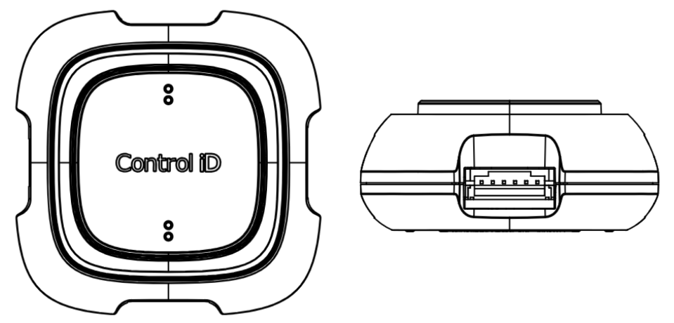
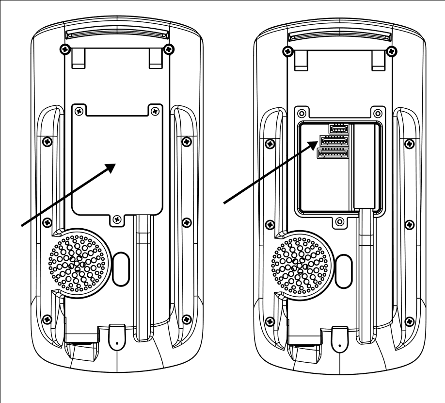

<!-- fonte: https://www.controlid.com.br/docs/access-api-pt/particularidade-dos-produtos/sinais-configuraveis-idface-max/ -->

# iDFace Max

O controlador de acesso [iDFace Max](https://www.controlid.com.br/controle-de-acesso/idface-max/) possui três tipos de sinais configuráveis: SecBox, relé interno e GPIOs de expansão.
Cada um desses sinais contém suas particularidades e possibilidades de customização para se adaptar às mais diversas necessidades.

## SecBox

A Security Box (SecBox) é um Módulo de Acionamento Externo (MAE) que se conecta ao iDFace Max através do conector de quatro pinos no verso do equipamento.


Esses pinos são utilizados para as seguintes funcionalidades:

| Pino | Cor | Descrição |
| --- | --- | --- |
| **+12V** | *Vermelho* | Alimentação +12V |
| **A** | *Azul* | Comunicação A |
| **B** | *Azul/Branco* | Comunicação B |
| **GND** | *Preto* | Terra da fonte |

Na SecBox é possível encontrar um conector de seis pinos para o controle de porta/relé externo, como mostrado na imagem abaixo.



Esses seis pinos seguem a seguinte especificação:

| Pino | Cor | Descrição |
| --- | --- | --- |
| **DS** | *Roxo* | Entrada para Sensor de Porta |
| **GND** | *Preto* | Terra (Comum) |
| **BT** | *Amarelo* | Entrada para Botoeira |
| **NC** | *Verde* | Contato Normalmente Fechado |
| **COM** | *Laranja* | Contato Comum |
| **NO** | *Azul* | Contato Normalmente Aberto |

### Configuração da SecBox

O relé externo pode ser configurado via API através dos seguintes parâmetros:

| Campo | Tipo | Descrição |
| --- | --- | --- |
| **sec_box_out_mode** | *string* | Modo de saída da SecBox:  **"0"**: Normal (Autorizados)  **"1"**: Somente Rejeitados  **"2"**: Campainha  **"3"**: Alarme |

Cada modo de saída estabelecido por `sec_box_out_mode` funciona da seguinte maneira:

| Modo de saída | Valor | Descrição |
| --- | --- | --- |
| **Normal (Autorizados)** | *0* | Aciona a SecBox ao ser realizada uma ação que desencadeie uma autenticação normal |
| **Somente Rejeitados** | *1* | Aciona a SecBox ao ser realizada uma ação que desencadeie uma rejeição de autenticação no equipamento |
| **Campainha** | *2* | Aciona a SecBox ao ser realizada uma ação que desencadeie o acionamento da campainha do dispositivo |
| **Alarme** | *3* | Aciona a SecBox ao ser realizada uma ação que desencadeie o acionamento do alarme do dispositivo |

### Exemplo de requisição para configuração da SecBox

A requisição deve ser feita através do método **POST** ao endpoint `/set_configuration.fcgi`.

Esta requisição configura o modo de saída da SecBox para operar em modo **normal (autorizados)**:

```
$.ajax({
    url: "/set_configuration.fcgi?session=" + session,
    type: "POST",
    contentType: "application/json",
    data: JSON.stringify({
        "general": {
            "sec_box_out_mode": "0"
        }
    })
});
```

## Relé interno

Na traseira do iDFace Max é possível encontrar um conector de sete pinos.



Esse conector possui a seguinte configuração de pinos:

| Pino | Cor | Descrição |
| --- | --- | --- |
| **GPIO1** | *Amarelo* | Pino Opcional 1 |
| **GPIO2** | *Amarelo* | Pino Opcional 2 |
| **GPIO3** | *Amarelo* | Pino Opcional 3 |
| **GND** | *Preto* | Terra (Comum) |
| **NC** | *Verde* | Contato Normalmente Fechado |
| **COM** | *Laranja* | Contato Comum |
| **NO** | *Azul* | Contato Normalmente Aberto |

Além do relé externo existente na SecBox, o iDFace Max possui um relé interno que pode ser configurado de acordo com as necessidades da instalação.
Para acessar o relé interno, existem três pinos de importância: **NC**, **COM** e **NO**.
Utilizando esses três pinos, é possível acoplar um módulo externo e acioná-lo de acordo com o comportamento desejado.

### Configuração do relé interno

O relé interno pode ser configurado via API através dos seguintes parâmetros:

| Campo | Tipo | Descrição |
| --- | --- | --- |
| **relay_out_mode** | *string* | Modo de saída do relé:  **"0"**: Normal (Autorizados)  **"1"**: Somente Rejeitados  **"2"**: Campainha  **"3"**: Alarme |
| **relay1_enabled** | *string* | **"0"**: Relé desabilitado  **"1"**: Relé habilitado |
| **relay1_auto_close** | *string* | **"0"**: Fechamento inteligente desabilitado  **"1"**: Fechamento inteligente habilitado |
| **relay1_timeout** | *string* | Tempo de abertura em milissegundos  *min*: **"100"**  *max*: **"10000"** |

Cada modo de saída estabelecido por `relay_out_mode` funciona da seguinte maneira:

| Modo de saída | Valor | Descrição |
| --- | --- | --- |
| **Normal (Autorizados)** | *0* | Aciona o relé interno ao ser realizada uma ação que desencadeie uma autenticação normal |
| **Somente Rejeitados** | *1* | Aciona o relé interno ao ser realizada uma ação que desencadeie uma rejeição de autenticação no equipamento |
| **Campainha** | *2* | Aciona o relé interno ao ser realizada uma ação que desencadeie o acionamento da campainha do dispositivo |
| **Alarme** | *3* | Aciona o relé interno ao ser realizada uma ação que desencadeie o acionamento do alarme do dispositivo |

### Exemplo de requisição para configuração do relé interno

A requisição deve ser feita através do método **POST** ao endpoint `/set_configuration.fcgi`.

Esta requisição **habilita** o relé interno para operar em modo **normal (autorizados)**, com **fechamento inteligente habilitado** e **tempo de abertura de 3 segundos**:

```
$.ajax({
    url: "/set_configuration.fcgi?session=" + session,
    type: "POST",
    contentType: "application/json",
    data: JSON.stringify({
        "general": {
            "relay1_enabled": "1",
            "relay_out_mode": "0",
            "relay1_auto_close": "1",
            "relay1_timeout": "3000"
        }
    })
});
```

## GPIOs de expansão

Na parte de trás do iDFace Max é possível encontrar um conector de sete pinos.


Esse conector possui a seguinte configuração de pinos:

| Pino | Cor | Descrição |
| --- | --- | --- |
| **GPIO1** | *Amarelo* | Pino Opcional 1 |
| **GPIO2** | *Amarelo* | Pino Opcional 2 |
| **GPIO3** | *Amarelo* | Pino Opcional 3 |
| **GND** | *Preto* | Terra (Comum) |
| **NC** | *Verde* | Contato Normalmente Fechado |
| **COM** | *Laranja* | Contato Comum |
| **NO** | *Azul* | Contato Normalmente Aberto |

Para estender as possibilidades de operação do iDFace Max, é possível utilizar as [GPIOs](http://pt.wikipedia.org/wiki/General_Purpose_Input/Output) de expansão. Estas consistem de três pinos: **GPIO1**, **GPIO2** e **GPIO3**.

É possível configurar o comportamento individual dessas GPIOs, para que o dispositivo execute a ação desejada ao receber um sinal através de seu respectivo pino.

### Configuração das GPIOs de expansão

As GPIOs podem ser configuradas via API através dos seguintes parâmetros.

| Campo | Tipo | Descrição |
| --- | --- | --- |
| **gpio_ext1_mode**  **gpio_ext2_mode**  **gpio_ext3_mode** | *string* | Modo de operação:  **"0"**: Desabilitado  **"1"**: Habilitar facial  **"2"**: Alarme  **"3"**: Emergência  **"4"**: Lockdown  **"5"**: Interfonia  **"6"**: Intertravamento  **"7"**: Abrir relé  **"8"**: Abrir SecBox  **"9"**: Abrir relé/SecBox |
| **gpio_ext1_idle**  **gpio_ext2_idle**  **gpio_ext3_idle** | *string* | Ativação:  **"0"**: Nível ativo 1, normalmente fechado (NC)  **"1"**: Nível ativo 0, normalmente aberto (NO) |

Cada modo de operação estabelecido por `gpio_extN_mode` (onde `N` indica o número da GPIO) funciona da maneira descrita na tabela abaixo.

Alguns sinais são acionados pelo fim do **pulso**, enquanto outros são acionados pelo nível de **sinal**.
\* **Pulso**: É esperada um ciclo de operação idle->ativo->idle. A ação é executada na borda de descida do pulso (i.e. transição ativo->idle).
\* **Sinal**: É esperado que o sinal seja fornecido de forma constante. *Ativo*: executa a ação continuamente; *idle*: interrompe ação.

Caso seja atribuído o mesmo modo de operação a mais de uma GPIO, seu funcionamento corresponderá a uma *lógica OU*, onde basta que ao menos uma das GPIOs seja ativada para que o respectivo modo de operação seja executado.
O modo de operação **Habilitar facial** é uma exceção, pois caso mais de uma GPIO seja configurada como tal, **todas** as GPIOS devem ser acionadas para que a funcionalidade entre em vigor, correspondendo a uma *lógica E*.

| Modo de operação | Valor | Detecção | Múltiplas GPIOs | Descrição |
| --- | --- | --- | --- | --- |
| **Desabilitado** | *"0"* | --- | --- | GPIO não realiza nenhuma operação |
| **Habilitar facial** | *"1"* | *Sinal* | *Lógica E* | Ao ativar a GPIO, habilita a identificação  A identificação se mantém desabilitada enquanto a GPIO estiver desativada |
| **Alarme** | *"2"* | *Pulso* | *Lógica OU* | Ao ativar a GPIO, aciona o alarme |
| **Emergência** | *"3"* | *Pulso* | *Lógica OU* | Ao ativar a GPIO, o equipamento entra em modo de emergência |
| **Lockdown** | *"4"* | *Pulso* | *Lógica OU* | Ao ativar a GPIO, o equipamento entra em modo de lockdown |
| **Interfonia** | *"5"* | *Pulso* | *Lógica OU* | Ao ativar a GPIO, o equipamento liga para o servidor SIP configurado |
| **Intertravamento** | *"6"* | *Sinal* | *Lógica OU* | Ao ativar a GPIO, impede a abertura da porta  A porta poderá receber comandos para abertura normalmente enquanto a GPIO estiver desativada |
| **Abrir relé** | *"7"* | *Pulso* | *Lógica OU* | Ao ativar a GPIO, aciona o relé interno do equipamento |
| **Abrir SecBox** | *"8"* | *Pulso* | *Lógica OU* | Ao ativar a GPIO, aciona o relé externo na SecBox |
| **Abrir relé/SecBox** | *"9"* | *Pulso* | *Lógica OU* | Ao ativar a GPIO, aciona o relé interno do equipamento em conjunto com o relé externo da SecBox |

### Exemplo de requisição para configuração das GPIOs de expansão

A requisição deve ser feita através do método **POST** ao endpoint `/set_configuration.fcgi`.

Esta requisição configura a **GPIO1** para **abrir o relé** com o comportamento **normalmente fechado**, a GPIO2 **desabilitada** e a GPIO3 para **abrir a SecBox** tendo comportamento **normalmente aberto**:

```
$.ajax({
    url: "/set_configuration.fcgi?session=" + session,
    type: "POST",
    contentType: "application/json",
    data: JSON.stringify({
        "general": {
            "gpio_ext1_mode": "7",
            "gpio_ext1_idle": "0",
            "gpio_ext2_mode": "0",
            "gpio_ext3_mode": "8",
            "gpio_ext3_idle": "1"
        }
    })
});
```
